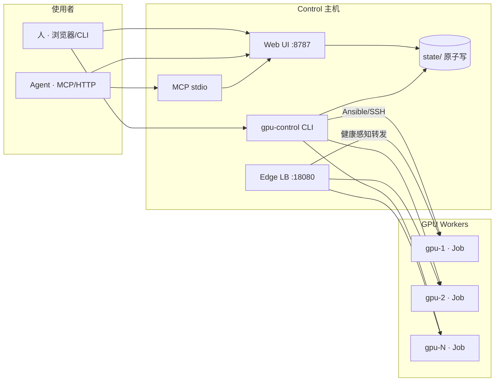

<!-- BEAUTIFIED -->
<h1 align="center">ComputeDeck</h1>

<p align="center">
  <strong>多节点 GPU 通用控制面</strong>
  <br />
  <em>Web · CLI · MCP · SSH/Ansible — 配置驱动，不绑死某一集群</em>
</p>

<p align="center">
  <a href="#快速开始"></a>
  <a href="LICENSE"></a>
  <a href="CHANGELOG.md"></a>
</p>

<p align="center">
  
  
  
  
</p>

<p align="center">
  技术仓库 / CLI：<code>gpu-control</code>
  ·
  <a href="docs/index.md">文档</a>
  ·
  <a href="CONTRIBUTING.md">贡献</a>
  ·
  <a href="SECURITY.md">安全</a>
</p>

---

## 背景：为什么需要 ComputeDeck？

实验室和业务团队手里往往有一批 **SSH 可达的 GPU 机器**，却没有（或不想上）完整 Kubernetes。常见痛点是：

- 卡被谁占了、进程在哪、能不能腾空 —— 靠群聊和 `nvidia-smi` 人肉对
- 微调 / 推理 / Ray 各写一套启停脚本，换机器就改路径、改端口
- 想给 Agent（Cursor 等）自动运维，却缺少统一的 HTTP / MCP 契约
- 上了 LiteLLM / nginx 又和「到底哪几张卡在服」脱节

**ComputeDeck**（技术名 `gpu-control`）就是这块「轻量控制面」：  
在 **一台 Control 主机** 上跑 Web UI + CLI + MCP，通过 Ansible/SSH 编排 worker；  
**不替代 K8s**，而是把「发现 → 租约 → 部署 Job → 健康 / 入口 → 日志」收成可复用框架。

灵感来自正经 README 的写法：[讲清背景与演示](https://github.com/xitu/gold-miner/blob/master/TODO1/how-to-write-beautiful-and-meaningful-readme-md-for-your-next-project.md)，以及结构化开源说明习惯。

## 它能做什么

| 能力 | 说明 |
|------|------|
| 单屏看板 | 健康评分、GPU 池、Edge/TLS/Gateway、快捷运维 |
| Job 插件 | JSON 描述启停；内置仅 `shell-job`，其余从模板安装 |
| 路径异构 | `defaults.paths` + 节点覆盖 + ``${paths.*}``，换集群不改框架代码 |
| 分布式 / 推理 | DeepSpeed hostfile、Ray、vLLM、torchrun / LLaMA-Factory 模板 |
| 统一入口 | 内置 Edge LB（重试/冷却/least-conn），可选 nginx / LiteLLM |
| Agent 友好 | OpenAPI、`/api/docs`、MCP `gc_*`、Cursor 示例配置 |
| 可靠性 | 状态原子写 + flock、watchdog 阈值重启、diagnose 一键检测 |

## 相对「脚本一把梭 / 直接上 K8s」的优势

1. **通用可搬家**：场景只进 `config/local/`；`config/examples/` 是中性模板，禁止把真实 IP/业务写进框架。
2. **控制面与算力分离**：UI/鉴权/调度在 Control；GPU worker 只跑 Job。
3. **模板组合能力**：训练、推理、Ray 都是可选模块，按需 `jobs install`。
4. **人机同一套 API**：浏览器、CLI、MCP Agent 走同一能力目录。
5. **内网可离线**：xterm 等静态资源内置，不依赖公网 CDN。

## 架构一览



## 支持边界

| 组件 | 要求 |
|------|------|
| 主控 | Linux（推荐）/ macOS；Python 3.11+；`uv`；Ansible；SSH |
| 工作节点 | Linux + NVIDIA GPU；SSH 免密；`nvidia-smi` |
| 可选 | Docker + NVIDIA Toolkit；vLLM / Ray / LLaMA-Factory / DeepSpeed 等 |

## 快速开始

```bash
uv venv .venv && uv pip install -r requirements.txt
./examples/quickstart.sh
cp -n config/examples/cluster.example.json config/local/cluster.json
cp -n config/examples/nodes.example.json   config/local/nodes.json
# 按你的集群改 host / 路径 / GPU 数 —— 不要提交 config/local
gpu-control node render
gpu-control doctor
gpu-control auth set-password --generate --enable   # 生产必须
gpu-control auth issue-token
gpu-control ui --background
gpu-control watchdog --background
```

UI 默认绑定 `127.0.0.1`（或 `cluster.control.ui_host`）。远程：

```bash
ssh -L 8787:127.0.0.1:8787 <control>
```

浏览器打开 `http://127.0.0.1:8787/`。

## 常用用法

```bash
# 总览与腾空
gpu-control overview
gpu-control free --node gpu-1 --wait 30 --cordon

# 从模板安装并部署
gpu-control jobs install train-job --name sft
gpu-control deploy sft --nodes gpu-1,gpu-2 --gpus 16
gpu-control jobs logs sft --node gpu-1 --lines 200

# 推理入口
gpu-control gateway ensure
gpu-control gateway status

# Agent / API
curl -s http://127.0.0.1:8787/api
# Authorization: Bearer $(cat config/local/secrets/ui_api_token)
```

更多：[手册](docs/手册.md) · [分布式与推理](docs/分布式与推理.md) · [高可用与负载均衡](docs/高可用与负载均衡.md) · [AI/MCP](docs/ai-接入.md)

## 仓库结构

```text
bin/            # gpu-control / gpu-control-mcp 入口
lib/            # 共享库（路径、鉴权、Job、端点、状态、OpenAPI）
scripts/        # CLI 子命令与运维脚本
web/            # HTTP/WebSocket 与静态 UI
mcp_server/     # MCP stdio
playbooks/      # Ansible
config/examples # 可提交中性模板
config/local/   # 本机场景与密钥（gitignore）
jobs/           # 内置通用 Job（shell-job）
examples/       # 参考管理脚本
docs/           # 中文 MkDocs
tests/          # 单元测试
```

完整约定见 [docs/develop/layout.md](docs/develop/layout.md)。

## 技术栈

| 层 | 技术 |
|----|------|
| 语言 | Python 3.11+ |
| 编排 | Ansible、Paramiko（SSH 终端） |
| 界面 | 原生 Web UI、本地 xterm.js |
| 文档 | MkDocs Material |
| 质量 | `scripts/check.sh`、unittest、GitHub Actions |
| 包管理 | `uv` |

## 校验

```bash
./scripts/check.sh
.venv/bin/python scripts/smoke_ui.py   # 需 UI + token
gpu-control doctor
```

## 品牌与命名

| 名称 | 用途 |
|------|------|
| **ComputeDeck** | 产品品牌：计算集群的「运维甲板」 |
| **gpu-control** | 仓库目录、Python 包名、CLI 命令（兼容现有脚本） |

若你更偏好全量重命名 CLI（例如 `cdeck`），可以开 Issue 讨论迁移窗口。

## 参与贡献

请阅读：

- [CONTRIBUTING.md](CONTRIBUTING.md) — 开发与发版
- [CODE_OF_CONDUCT.md](CODE_OF_CONDUCT.md) — 行为准则
- [GOVERNANCE.md](GOVERNANCE.md) — 决策方式
- [SUPPORT.md](SUPPORT.md) — 求助渠道

流程概要：Fork → 分支 → `./scripts/check.sh` → PR（使用模板）。

## 许可证

**GNU Affero General Public License v3.0（AGPL-3.0）** — 见 [LICENSE](LICENSE) 与 [NOTICE](NOTICE)。

相对 MIT 更「紧」：分发修改版须开源；若通过网络提供本软件的修改版（例如托管控制面），也须向使用者提供对应完整源码。版权归属见 [AUTHORS](AUTHORS)。

版本：[`VERSION`](VERSION) · 变更：[CHANGELOG.md](CHANGELOG.md)
