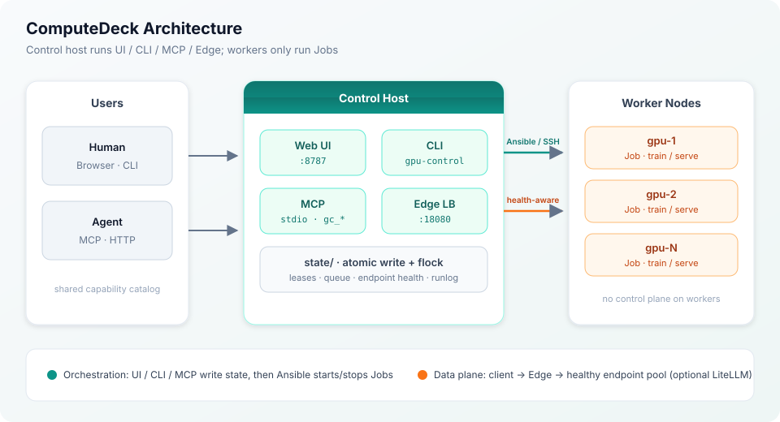

<p align="center">
  
</p>

<h1 align="center">ComputeDeck</h1>

<p align="center">
  <strong>多节点 GPU 控制面</strong>
  <br />
  <em>Web · CLI · MCP · 配置驱动</em>
</p>

<p align="center">
  <a href="https://github.com/AlexanderJ-Carter/ComputeDeck"></a>
  <a href="LICENSE"></a>
  <a href="CHANGELOG.md"></a>
</p>

<p align="center">
  
  
  
  
</p>

<p align="center">
  命令行 <code>gpu-control</code>
  ·
  <a href="https://github.com/AlexanderJ-Carter/ComputeDeck">GitHub</a>
  ·
  <a href="https://alexanderj-carter.github.io/ComputeDeck/">宣传展板</a>
  ·
  <a href="docs/index.md">文档</a>
  ·
  <a href="CONTRIBUTING.md">贡献</a>
  ·
  <a href="SECURITY.md">安全</a>
</p>

---

## 这是什么

实验室和业务团队手里常有一批 SSH 就能登上的 GPU 机器。卡谁在用、进程在哪、能不能腾空，往往靠群聊和 `nvidia-smi`；微调、推理、Ray 各自一套启停脚本；想让 Cursor 这类 Agent 帮忙运维，又缺少统一的 HTTP / MCP 契约。

**ComputeDeck**（命令行仍为 `gpu-control`）把发现、租约、Job 部署、健康检查、统一入口和日志收成一套控制面。一台 Control 主机跑 Web UI、CLI 和 MCP，用 Ansible/SSH 编排 worker。场景写在 `config/local/`，换集群主要改配置。宣传展板见 [`demo/`](demo/)（GitHub Pages）。

## 能力

| 能力 | 说明 |
|------|------|
| 单屏看板 | 健康评分、GPU 池、Edge / TLS / Gateway 状态 |
| Job 插件 | JSON 描述启停；`jobs install --recommended` 一键装推理 / 训练 / Ray / Docker 模板 |
| 路径异构 | `defaults.paths`、节点覆盖、`${paths.*}` |
| 统一入口 | 内置 Edge LB（重试、冷却、least-conn），可挂 nginx / LiteLLM |
| Agent | OpenAPI + `gc_*` MCP，与 CLI 同一能力面 |
| 可靠性 | 状态 flock 原子写、watchdog、diagnose（含租约漂移提示） |

## 架构

<p align="center">
  
</p>

控制面在 Control（Web / CLI / MCP / Edge + `state/`）；Worker 只跑 Job。编排走 Ansible/SSH，推理走 Edge 健康转发。

## 快速开始

```bash
git clone https://github.com/AlexanderJ-Carter/ComputeDeck.git
cd ComputeDeck
uv venv .venv && uv pip install -r requirements.txt
./examples/quickstart.sh
cp -n config/examples/cluster.example.json config/local/cluster.json
cp -n config/examples/nodes.example.json   config/local/nodes.json
# 按集群改 host、路径、GPU 数与 scheduling.unit_gpus
gpu-control node render
gpu-control doctor
gpu-control jobs install --recommended
gpu-control auth set-password --generate --enable
gpu-control auth issue-token
gpu-control ui --background
gpu-control watchdog --background
```

容器起控制面（可选）：`docker compose up -d --build`，见 [`docs/develop/docker.md`](docs/develop/docker.md)。  
发版镜像：`ghcr.io/alexanderj-carter/computedeck`（**不发 PyPI / npm**；仓库即控制面）。

本机看 UI（主控在远端时）：

```bash
ssh -L 8787:127.0.0.1:8787 <control>
# 浏览器 http://127.0.0.1:8787/
```

### Agent / MCP

同一入口 `bin/gpu-control-mcp`；示例在 `config/examples/mcp.*`（Cursor / Claude Code / Codex / Continue / Windsurf）。  
Claude Code 也可复制 [`.mcp.json.example`](.mcp.json.example) → `.mcp.json` 再改绝对路径与 Token。  
约定：[AGENTS.md](AGENTS.md) · [CLAUDE.md](CLAUDE.md) · [docs/ai-接入.md](docs/ai-接入.md)。

```bash
uv pip install -r requirements-mcp.txt
gpu-control auth issue-token   # → GPU_CONTROL_API_TOKEN
```

发版准备：`python scripts/prepare_release.py --bump minor`（不 push）。  
同步到已有 control：`CONTROL_HOST=<host> ./scripts/deploy_control.sh`。

## 常用命令

```bash
gpu-control overview
gpu-control free --node gpu-1 --wait 30 --cordon
gpu-control jobs templates
gpu-control deploy sft --nodes gpu-1,gpu-2 --gpus 16
gpu-control gateway ensure
curl -s -H "Authorization: Bearer $TOKEN" http://127.0.0.1:8787/api
```

文档：[手册](docs/手册.md) · [配置参考](docs/配置参考.md) · [分布式](docs/分布式与推理.md) · [高可用](docs/高可用与负载均衡.md) · [AI/MCP](docs/ai-接入.md)

## 环境与校验

| 组件 | 要求 |
|------|------|
| 主控 | Linux（推荐）/ macOS；Python 3.11+；`uv`；Ansible；SSH |
| 工作节点 | Linux + NVIDIA GPU；SSH 免密；`nvidia-smi` |
| 可选 | Docker + NVIDIA Toolkit；vLLM / Ray / LLaMA-Factory / DeepSpeed 等 |

```bash
./scripts/check.sh
gpu-control doctor
```

## 仓库说明

| 路径 | 用途 |
|------|------|
| `bin/gpu-control` | CLI 入口 |
| `web/` | UI 与 HTTP API |
| `mcp_server/` | MCP（`gc_*`） |
| `config/examples/` | 可提交的示例配置、Job 模板与 MCP 客户端样例 |
| `config/local/` | 本机场景（gitignore，勿提交） |
| `jobs/` | 内置 `shell-job`；业务 Job 装到 `config/local/jobs/` |
| `docs/` | 手册与 MkDocs 源 |
| `AGENTS.md` / `CLAUDE.md` | 多 Agent 约定（Codex / Claude Code 等会读） |

## 参与与许可

[CONTRIBUTING](CONTRIBUTING.md) · [SECURITY](SECURITY.md) · [SUPPORT](SUPPORT.md) · [Issues](https://github.com/AlexanderJ-Carter/ComputeDeck/issues)

**AGPL-3.0-only**，见 [LICENSE](LICENSE) / [NOTICE](NOTICE)。版本见 [`VERSION`](VERSION) · [CHANGELOG](CHANGELOG.md)。
