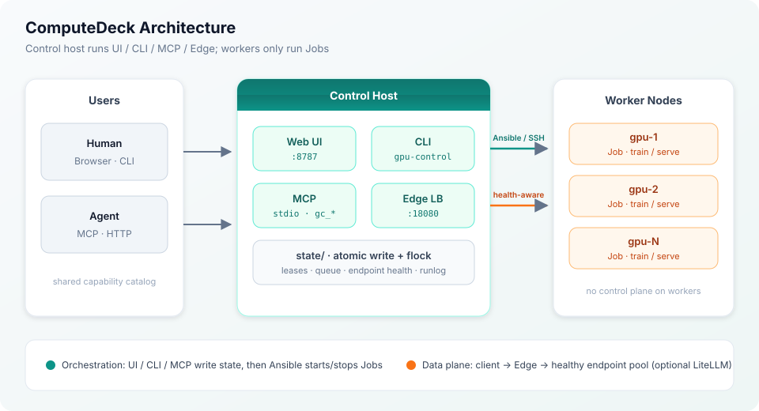

# ComputeDeck 文档

<p align="center">
  
</p>

**ComputeDeck**（[仓库](https://github.com/AlexanderJ-Carter/ComputeDeck) · 命令 `gpu-control` · [宣传展板](https://alexanderj-carter.github.io/ComputeDeck/)）是多节点 GPU 控制面：Web、CLI、MCP，SSH / Ansible 编排。场景在 `config/local/`。许可证 **AGPL-3.0**。



| 入口 | 说明 |
|------|------|
| [上手与运维手册](手册.md) | 安装、节点、Job、Gateway、腾空 |
| [生产部署](生产部署.md) | systemd、端口、发布清单 |
| [安全加固](安全加固.md) | 鉴权、Token、TLS |
| [配置参考](配置参考.md) | cluster / nodes / jobs / models |
| [分布式与推理](分布式与推理.md) | DeepSpeed、Ray、vLLM、微调 |
| [高可用与负载均衡](高可用与负载均衡.md) | Edge、watchdog、AI Gateway |
| [升级与备份](升级与备份.md) | 升级、回滚、迁移 |
| [故障排查](故障排查.md) | 常见症状 |
| [AI / MCP 接入](ai-接入.md) | Cursor / Claude Code / Codex 等 Agent、Bearer、助手 |
| [容器部署](develop/docker.md) | 控制面 Docker / GHCR（不发 PyPI） |
| [HTTP API](api/index.md) | 分组与示例 |
| [OpenAPI](api/openapi.md) | `/api/docs` |
| [开发约定](develop/docstrings.md) | Docstring · [布局](develop/layout.md) · [CI](develop/ci.md) |

## 控制面在线时

- UI：`http://<control>:8787/`
- API 目录：`/api`
- OpenAPI JSON：`/api/openapi.json`
- Swagger：`/api/docs`
- 文档站：`/help/`（先执行 `gpu-control docs build`）

```bash
uv pip install -r requirements-docs.txt
gpu-control docs build    # → web/static/help/
gpu-control docs serve    # 本地预览 :8000
```

## 质量门禁

```bash
./scripts/check.sh
.venv/bin/python scripts/smoke_ui.py
gpu-control doctor
```

版本见仓库根 `VERSION`，变更见 `CHANGELOG.md`。
