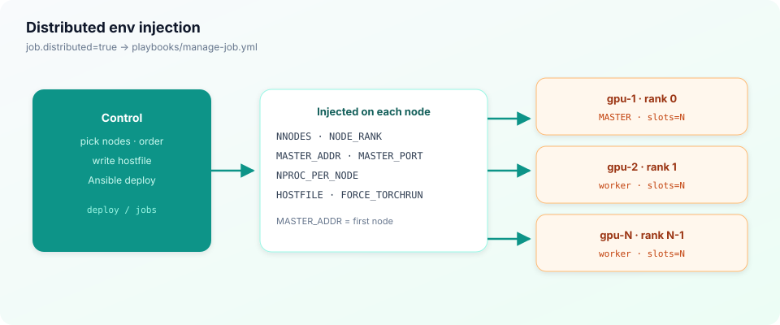

# 分布式训练与推理

控制面负责选机、注入分布式拓扑、启停、日志与就绪检查。  
LLaMA-Factory、DeepSpeed、torchrun、accelerate、Ray、vLLM 等由节点环境提供，ComputeDeck 用 Job 模板把它们接进同一套调度。

## 1. 分布式环境注入



`job.distributed = true` 时，`playbooks/manage-job.yml` 对本次选中节点注入 `NNODES`、`NODE_RANK`、`MASTER_ADDR`、`MASTER_PORT`、`NPROC_PER_NODE`、`HOSTFILE`、`FORCE_TORCHRUN=1`，以及同名的 `GPU_CONTROL_*` 副本。运行时目录同时写入 hostfile：`<node-ip> slots=<nproc_per_node>`。

`MASTER_ADDR` 取本次节点列表第一台的 `ansible_host`；`NODE_RANK` 按本次列表顺序。
**同一个训练任务重启用相同节点顺序**，避免 rank 变化。

运行时目录优先取 Job 环境变量：

```json
"env": {
  "GPU_CONTROL_JOB_NAME": "sft",
  "GPU_CONTROL_JOB_RUNTIME": "${paths.workdir}/gpu-control-jobs/sft"
}
```

日志：`<runtime>/job.log`；pid：`<runtime>/job.pid`。运行时目录放在 `${paths.workdir}` 下，避免放在重启会清空的 `/tmp`。

## 1.1 两台 4 卡机当一个 8 卡作业

这是“作业级协同”，不是把两台机器合并成一张虚拟 8 卡 GPU；显存不会合并，通信由 NCCL / DeepSpeed / torchrun 完成。

先规划：

```bash
gpu-control plan-job --gpus 8 --job train-job
```

它会输出：

- 选中的节点和 rank；
- `MASTER_ADDR` / `MASTER_PORT`；
- `NPROC_PER_NODE`；
- hostfile 行，例如 `10.0.0.1 slots=4`；
- 告警：节点不足、卡数不一致、Job 没有 `distributed=true`、节点离线 / 被租用等。

确认后部署：

```bash
gpu-control deploy train-job --nodes gpu-1,gpu-2 --gpus 8
```

前提：

- 两台机器的 GPU 型号、驱动、CUDA / NCCL 版本一致；
- 节点之间能互访 `MASTER_ADDR:MASTER_PORT`（默认 29500），防火墙放行；
- 模型、数据集、输出目录在两边都能访问（共享盘或相同路径）；
- Job 是 `distributed=true`，`gpus_per_node` 与实际卡数一致；
- 多机 InfiniBand / RoCE 需要节点侧已配好，控制面只注入环境变量，不配置网络。

## 2. 训练模板

```bash
gpu-control toolkits install --bundle train-stack   # LLaMA-Factory/DeepSpeed/Accelerate/PEFT
gpu-control jobs install train-job --name sft
gpu-control deploy sft --nodes gpu-1,gpu-2 --gpus 16
```

| 模板 | launcher | 说明 |
|------|----------|------|
| `train-job` | LLaMA-Factory | 指向示例 YAML，复制后改数据集/输出目录 |
| `llamafactory-train` | LLaMA-Factory | 指向你自己的 `sft.yaml` |
| `deepspeed-train` | DeepSpeed | 自动带 `--hostfile`（多机） |
| `torchrun-train` | torchrun | 静态 rendezvous |
| `ray-cluster` | Ray | rank0 head + 其余 worker |

`examples/train_manager.py` 支持：

```bash
python examples/train_manager.py start --launcher llamafactory --config /path/sft.yaml
python examples/train_manager.py start --launcher torchrun -- train.py --epochs 1
python examples/train_manager.py start --launcher deepspeed --deepspeed ds_z2.json -- train.py
python examples/train_manager.py start --launcher accelerate -- train.py
```

### 微调产物

训练输出目录由 YAML / 参数决定（例如 `${paths.model_root}/saves/sft`）。  
训练完成后若希望登记为可部署模型，可编辑 `config/local/models.json` 的 `models[]` 并指向该目录。

## 3. Ray

安装：

```bash
gpu-control toolkits install --id ray      # 或 --bundle ray-stack
gpu-control jobs install ray-cluster --name ray
gpu-control deploy ray --nodes gpu-1,gpu-2 --gpus 8
```

`examples/ray_manager.py` 行为：

- rank 0：`ray start --head --port 6379 --dashboard-port 8265`
- 其他：`ray start --address=<MASTER_ADDR>:6379`
- `status/wait` 通过 `ray status` 判断
- Dashboard：`http://<master>:8265`

提交任务：

```bash
gpu-control exec --nodes <head> -- ray job submit --address http://127.0.0.1:8265 -- python train.py
```

Ray 跨机 vLLM 的 TP/PP、Ray Train 等建立在同一集群上；控制面只负责把它拉起来。

## 4. vLLM

### 进程模式（推荐先跑通）

```bash
gpu-control jobs install vllm-serve --name vllm
gpu-control deploy vllm --nodes gpu-1 --gpus 4
```

`examples/vllm_serve.py` 会：

- 启动 `python -m vllm.entrypoints.openai.api_server ...`
- `start/stop/status/wait`；
- `wait` 做**真实就绪检查**：优先 `GPU_CONTROL_HEALTH_URL`，否则探测 `--port`；
- 日志与 pid 写入 `GPU_CONTROL_JOB_RUNTIME`。

### Docker 模式

```bash
gpu-control jobs install vllm-docker --name vllm-docker
```

注意端点池模型：`cluster.api`/`nodes.json` 默认按「每 GPU 一个端口」生成端点；
vLLM 单容器 TP=4 通常只开一个端口。对齐方式：

```json
// nodes.json
"gpu-1": {
  "ansible_host": "10.0.0.11",
  "gpus_per_node": 4,
  "base_port": 8000,
  "ports_per_node": 1
}
```

然后 `gpu-control endpoints --refresh`，健康探测与 LiteLLM / Edge upstream 只会使用 8000。

### 统一入口

```bash
gpu-control gateway ensure
gpu-control gateway status
```

Edge/LiteLLM 读取 `cluster.gateway`；推理端点鉴权仍由推理服务/网关负责。

## 5. 就绪语义

| 类型 | `wait` 检查 |
|------|-------------|
| service 进程（vLLM） | pid 存活 + HTTP/TCP 就绪 |
| docker | 容器 running（如需真实就绪，用 `vllm_serve.py` 进程模式） |
| 训练 | 目前主要检查进程存活；失败请查看 `job.log`，必要时用 `gpu-control exec ... tail` |

训练类 Job 的 `deploy` 成功不等于训练成功；建议启动后观察 `job.log` 或接入外部监控。
