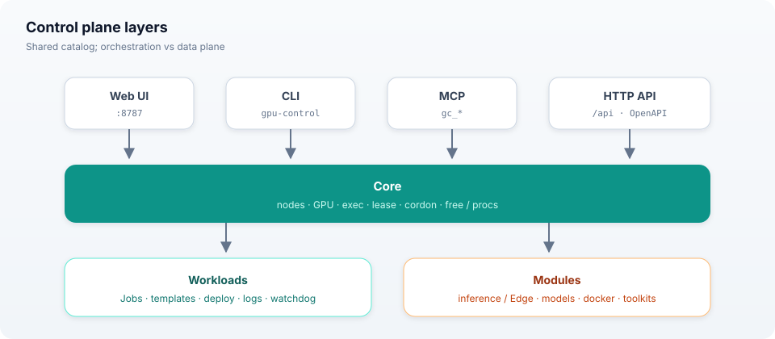

# ComputeDeck 手册

ComputeDeck（命令：`gpu-control`）在主控上编排多台 GPU 机，底层是 SSH 与 Ansible。  
推理、模型下载、Docker、Ray 等按 Job 模板按需启用。

版本见仓库根 `VERSION`，变更见 `CHANGELOG.md`。

---

## 1. 角色与安装

| 角色 | 机器 | 跑什么 |
|------|------|--------|
| **主控 control** | 一台 CPU 机（写在 `cluster.control`） | UI、CLI、Ansible |
| **工作节点** | 若干 GPU 机（写在 `nodes.nodes`） | Job / 推理；管理台放在主控 |

```bash
# 在主控上
cd /path/to/gpu-control
uv venv .venv && uv pip install -r requirements.txt
./examples/quickstart.sh
# 编辑 config/local/{cluster,nodes}.json
gpu-control node render
gpu-control doctor
gpu-control ui --background
# 本机隧道：ssh -L 8787:127.0.0.1:8787 <control>
```

配置查找：`config/local/` → `config/` → 仓库根。密钥与内网 IP 只放 `config/local`（gitignore）。

### 1.1 控制面鉴权（重要）

UI / `/api/*` / 终端 WebSocket 支持可插拔鉴权（`cluster.control.auth`）：

| mode | 说明 |
|------|------|
| `none` | 关闭鉴权；配合 SSH 隧道做内网调试时，`doctor` 会提示开启鉴权 |
| `password` | scrypt 密码 + HttpOnly Session；可发 API Bearer Token |
| `oidc` | OpenID Connect 授权码 + PKCE；浏览器跳 IdP；API 使用 Bearer |

```bash
gpu-control auth set-password --generate --enable
gpu-control auth issue-token          # MCP / 脚本用
gpu-control auth status
gpu-control auth oidc-check           # 探测 discovery
```

登录：`POST /api/auth/login`（密码）或 `GET /api/auth/oidc/login`（OIDC）；Agent 带 `Authorization: Bearer <token>`。  
HTTPS 终止后可设 `GPU_CONTROL_UI_SECURE=1` 给 Cookie 加 `Secure`。  
强制要求开启鉴权：`GPU_CONTROL_REQUIRE_AUTH=1 gpu-control doctor`。

#### OIDC（企业 IdP）

在 `cluster.control.auth`：

```json
"mode": "oidc",
"oidc": {
  "issuer": "https://login.example.com",
  "client_id": "gpu-control",
  "client_secret_file": "config/local/secrets/oidc_client_secret",
  "redirect_path": "/api/auth/oidc/callback",
  "scopes": ["openid", "profile", "email"],
  "username_claim": "email",
  "allowed_emails": ["you@example.com"],
  "allow_password_fallback": false
}
```

1. IdP 登记回调：`http(s)://<control>:8787/api/auth/oidc/callback`  
2. `echo 'secret' > config/local/secrets/oidc_client_secret && chmod 600 ...`  
3. `gpu-control auth set-mode oidc && gpu-control auth oidc-check`  
4. 浏览器打开 UI →「使用企业账号登录」

可选白名单：`allowed_emails` / `allowed_subjects` / `allowed_groups`。  
`allow_password_fallback: true` 时可同时保留密码登录。

---

## 2. 依赖分层

### 2.1 主控（必须）

`requirements.txt` / `pyproject.toml`：

- `ansible` — 并行下发
- `paramiko` — Web 交互终端 PTY

安装：`uv pip install -r requirements.txt`

### 2.2 工作节点 · 模型拉取（按需）

下模型时，**节点上**需要其一：

| 工具 | 包 | 用途 |
|------|-----|------|
| Hugging Face | `huggingface_hub`（有 CLI 更好） | `models pull` 优先；无 CLI 时用 `snapshot_download` |
| ModelScope | `modelscope` | HF 之外的备选源 |

```bash
# 检查节点是否已装
gpu-control models deps

# 用节点 paths.python 安装（需网络）
gpu-control models install-tools --nodes all
# 或指定：--node gpu-1
```

Worker 可选清单：`requirements-models-worker.txt`（给人工/脚本参考，不装在主控 venv）。

镜像（可选，写在节点环境或 pull 前 export）：

- HF：`HF_ENDPOINT=https://hf-mirror.com`
- ModelScope：按官方文档设置 cache

### 2.3 Docker Job（按需）

节点需 `docker` + NVIDIA Container Toolkit。  
当前集群 worker **未装 docker** 时请用 `runtime: process`。

---

## 3. Web 页面

| 页面 | 用途 |
|------|------|
| **看板** | 健康评分、GPU 池、API / Edge / TLS、快捷运维 |
| **节点矩阵** | 节点瓦片、GPU 分段、隔离、腾空、进程、终端入口 |
| **任务** | 选节点、启停 Job、模板安装、部署、队列与 Lease |
| **模型** | 路径、校验、拉权重，并可回填到任务参数 |
| **工具栈** | LLaMA-Factory / DeepSpeed / vLLM / Ray 探测与安装 |
| **节点** | 增删 inventory 节点 |
| **API 端点** | 健康探测、LB / nginx / 网关片段、统一入口启停 |
| **命令** | 批量 exec、跑远端 Python |
| **终端** | 交互 SSH PTY（vim / top 等） |
| **指南 / 配置** | 上手步骤、向导、检查清单、Job / nodes 编辑 |

顶栏 **实时** 会自动刷新总览。底部 **批量输出** 展示命令结构化结果；需要交互会话时用 **终端**。

---

## 4. 路径（目录不一致怎么配）

`config/local/nodes.json`：

```json
"defaults": {
  "paths": {
    "python": "/usr/bin/python3",
    "model_root": "/data/models",
    "workdir": "/tmp/gpu-workdir",
    "cache": "/data/hf-cache"
  }
},
"nodes": {
  "gpu-x": { "paths": { "python": "/other/bin/python" } }
}
```

Job / `models.json` 写 `${paths.python}`、`${paths.model_root}/...`。  
启停与检查时按节点合并后再执行。

```bash
gpu-control models paths
gpu-control models paths --node gpu-1
```

---

## 5. 模型：声明 · 下载 · 校验

### 5.1 配置

```bash
cp config/examples/models.example.json config/local/models.json
```

要点：

- `caches[]`：缓存根（可 `${paths.cache}`）
- `models[]`：`id` / `repo` / `path` / `launch.extra_args` / `verify`
- `pull.tool`：`huggingface-cli` | `modelscope` | `auto`

### 5.2 命令

```bash
gpu-control models list
gpu-control models deps              # 节点：HF / ModelScope / docker
gpu-control models check             # 路径是否存在 + 磁盘
gpu-control models verify            # 按 verify 规则校验文件/最小体积
gpu-control models pull --model <id> # 或 --name org/repo --cache <cache-id>
gpu-control models install-tools     # 节点 pip 安装拉取工具
```

下载落盘：

1. 模型声明了 `path` → 拉到该目录（ModelScope `--local_dir`）
2. 否则用 `cache` / `pull.default_cache` 指向的缓存根（HF `HF_HUB_CACHE`）

### 5.3 校验规则（`models[].verify`）

```json
"verify": {
  "expect_files": ["config.json"],
  "min_bytes": 1000000
}
```

`models verify`：目录存在、必要文件在、总大小 ≥ `min_bytes`。

---

## 6. 任务（Job）

**Job = 一份 JSON + 远端管理脚本**（start / stop / status / wait）。  
框架内置通用 `shell-job`；推理、训练、领域 Job 用模板安装，或直接放到 `config/local/jobs/`。

| 来源 | 路径 | 说明 |
|------|------|------|
| 内置 | `jobs/*.json` | 通用 `shell-job` 契约示例 |
| 本机 | `config/local/jobs/*.json` | 场景 Job（同名优先） |
| 模板 | `config/examples/*.example.json` | `http-serve`、`train-job`、`deepspeed-train`、`ray-cluster`、`vllm-serve`、`vllm-docker`、`docker-job` 等 |

```bash
gpu-control jobs              # 已安装（local + 内置 shell-job）
gpu-control jobs templates    # 可安装模板（★ = 推荐）
gpu-control jobs install --recommended   # 一键推荐包（推理/训练/Ray/Docker）
gpu-control jobs install http-serve --name my-api
gpu-control jobs install train-job --name sft
gpu-control jobs logs sft --node gpu-1 --lines 200   # 尾部日志
gpu-control diagnose check    # 一键检测
gpu-control diagnose repair   # 安全自动修复
gpu-control logs              # 运行日志
```

| 字段 | 说明 |
|------|------|
| `runtime` | `process`（默认）或 `docker`；doctor 强校验 |
| `kind` | `service`（推理/常驻）或 `train`（微调） |
| `wait` | process=管理脚本自定就绪；docker=仅容器 running（见 `jobs/README.md`） |
| `distributed` | `true` 时按本次选中节点注入 `NNODES`/`NODE_RANK`/`MASTER_ADDR`/`MASTER_PORT`/`NPROC_PER_NODE` |
| `gpus_per_node` / `nproc_per_node` | 每节点卡数；后者默认等于前者 |
| `master_port` | 多机 rendezvous 端口（默认 29500） |
| `python` / `script` | process；支持 `${paths.*}`（含 `paths.repo`） |
| `extra_args` | 启动参数 |
| `docker` | image / ports / volumes / command |
| `model` | 可选，关联 `models[].id` |

```bash
cp config/examples/shell-job.example.json config/local/jobs/myjob.json
# 编辑 name / python / script
gpu-control start myjob --node gpu-1
gpu-control deploy myjob --gpus 4
# cluster.default_job 写成你的 Job 名，CLI/UI 缺省就用它
```

### 6.1 微调 / 分布式训练

控制面把常用栈做成**一站式工具栈**（探测 + pip 安装到节点 `${paths.python}`），再配合 Job 启停：

```bash
gpu-control toolkits list
gpu-control toolkits probe
gpu-control toolkits install --bundle train-stack   # LF + DeepSpeed + Accelerate + PEFT
gpu-control toolkits install --bundle serve-stack   # vLLM + openai
# 也可：--id llamafactory --id deepspeed
```

UI「工具栈」页同样可探测/安装。训练本体仍跑在节点环境；控制面负责：选机 → 注入多机环境 → 启停 Job → lease。

| 模板 | launcher | 说明 |
|------|----------|------|
| `train-job` | `llamafactory` | 通用入口，改 `--config` |
| `llamafactory-train` | `llamafactory` | 多机 SFT/LoRA |
| `deepspeed-train` | `deepspeed` | 任意 `train.py` + ZeRO |
| `torchrun-train` | `torchrun` | DDP/FSDP 脚本 |

```bash
gpu-control toolkits install --bundle train-stack
gpu-control jobs install train-job --name sft

# 改 YAML：模型路径、数据集、output_dir、可选 deepspeed: .../ds_z2_config.json
cp examples/train/llamafactory_lora_sft.example.yaml /path/to/your_sft.yaml

# 单机 / 多机（节点顺序 = NODE_RANK；第一台为 MASTER_ADDR）
gpu-control start sft --node gpu-1 \
  --arg --launcher --arg llamafactory \
  --arg --config --arg /path/to/your_sft.yaml
gpu-control deploy sft --nodes gpu-1,gpu-2 --gpus 16 --restart

gpu-control status sft --nodes gpu-1,gpu-2
gpu-control exec --node gpu-1 --preset train-log
```

管理脚本：`examples/train_manager.py`（`llamafactory|torchrun|deepspeed|accelerate|raw`）。  
DeepSpeed 示例配置：`examples/deepspeed/ds_z{2,3}_config.json`。  
`wait` 表示**训练进程已拉起**，不是训练结束；结束后 `status` 变 NOT READY，再 `free` 腾卡。

### 6.2 队列与租约

调度记账在主控 `state/`（flock 串行，见[生产部署 · state 契约](生产部署.md)）。**没有常驻调度器**：入队后需 `queue schedule`（或 submit 时 `--schedule`）。

**队列状态机**（`state/queue.json`）

```text
pending → admitted → running → ready
                 ↘            ↘ failed
cancelled（仅 pending/admitted 可取消）
```

| 状态 | 含义 |
|------|------|
| `pending` | 已入队，未占机 |
| `admitted` | 本轮 schedule 已认领，正在选机 |
| `running` | 已选机，正在 `deploy` |
| `ready` | 部署成功并已登记租约 |
| `failed` | 部署失败 |
| `cancelled` | 用户取消 |

```bash
gpu-control queue submit sft --gpus 8
gpu-control queue schedule
gpu-control queue cancel --id wl-…
gpu-control get queue
```

**租约生命周期**（`state/leases.json`）

| 事件 | 行为 |
|------|------|
| `deploy` / `start` 成功路径 | `acquire`（按节点登记） |
| `stop` / `free` 成功 | `release` 对应节点 |
| 进程崩溃、`procs kill` | **不**自动对账；`diagnose check` 会提示「租约漂移」 |

`deploy` 若目标节点已有**异主**租约：默认拒绝；`--force` 先 release 再部署。同名 Job 重入可跳过重复 acquire。

```bash
gpu-control lease list
gpu-control lease release --id lease-…
gpu-control free --node gpu-1          # 停 Job + 杀进程 + 释租约
gpu-control diagnose check             # 含租约/GPU 快照对账提示
```

---

## 7. 腾空 / 进程 / 隔离
腾空本质：**停掉占卡进程**，让 GPU 空出来。

```bash
# 看谁占着卡
gpu-control procs list --node NAME
gpu-control procs list --node NAME --refresh   # 刷新快照后表格输出

# 只杀进程（不走 Job stop）
gpu-control procs kill --node NAME --all
gpu-control procs kill --node NAME --pid 12345
gpu-control procs kill --node NAME --match my-serving

# 腾空：停注册 Job + 杀 GPU 进程 + 释 lease + 校验
gpu-control free --node NAME
gpu-control free --node NAME --wait 30
gpu-control free --node NAME --cordon
gpu-control free --node NAME --no-kill         # 只停 Job，不杀进程

gpu-control node cordon NAME                  # 只隔离，不停任务
gpu-control node uncordon NAME
```

Web「节点矩阵」点节点：进程表、单 PID 结束、结束全部、腾空。

隔离后：`deploy` / `start` / 自动选机 / watchdog **会跳过**（除非 `--allow-cordoned`）。

---

## 8. API 端点与统一入口（Gateway）

对外只暴露 **Control 一个端口**；GPU 节点留在内网。

```bash
gpu-control endpoints
gpu-control health
gpu-control gateway ensure          # 渲染产物 + 按 ingress.kind 拉起主入口（推荐）
gpu-control gateway status          # companions：Edge / nginx / LiteLLM 角色与状态
# 客户端打：http://<control>:18080/<path>   （不再直连各 GPU IP）
```

| 配套 | 角色 | 说明 |
|------|------|------|
| **Edge** | 默认主入口 | 内置反代，无需 root；`ensure` 会拉起 |
| **nginx** | 可选替代 | kind=edge 时**不必装**；有 root 才 `apt install nginx` + include conf |
| **LiteLLM** | 可选 OpenAI 层 | 配 `openai_proxy_dir` 或 `pip install 'litellm[proxy]'`；不配也不算故障 |

| kind | 作用 |
|------|------|
| `edge` | **内置**反向代理（推荐，无需 root/nginx） |
| `litellm` | 启动/对接 OpenAI 兼容代理 |
| `nginx` | 写出 conf；有 nginx 时自行 `include` + reload |
| `both` | edge + litellm |

`cluster.gateway.ingress` 常用字段：

| 字段 | 含义 |
|------|------|
| `bind` / `port` / `public_base_url` | 对外监听 |
| `domain` / `domains` | 对外域名（写入 nginx `server_name`、推导 URL） |
| `tls.enabled` | 启用 HTTPS（Edge 用标准库 `ssl` 包装监听） |
| `tls.cert_file` / `key_file` | 证书与私钥路径（可用 `config/local/secrets/`） |
| `tls.ca_file` | 可选 CA；`require_client_cert` 开客户端证书校验 |
| `strategy` | `round_robin`（默认）或 `least_conn` |
| `retries` | 连接失败时换上游重试次数（默认 2） |
| `cooldown_sec` | 失败上游冷却（默认 30s，借鉴 LiteLLM cooldown） |
| `sticky_header` | 非空则按该请求头做粘性哈希（可选） |

HTTPS 示例（证书放到 secrets 后）：

```json
"ingress": {
  "domain": "api.example.com",
  "public_base_url": "https://api.example.com:18080",
  "tls": {
    "enabled": true,
    "cert_file": "config/local/secrets/ingress.crt",
    "key_file": "config/local/secrets/ingress.key"
  }
}
```

改完执行 `gpu-control gateway ensure`（或 UI「规整启动」）。配置页「集群策略」也可填域名 / 证书。

端口按节点：`ports_per_node` → `gpus_per_node` → `cluster.api`。  
虚拟密钥 / 预算 / Redis 仍交给 LiteLLM 等产品；gpu-control 只做发现 + 健康 + Control 入口 LB。

### 分层

| 层 | 职责 | 怎么跑 |
|----|------|--------|
| Backends | 每卡 HTTP | Job on workers |
| Edge LB | Control 统一 HTTP 入口 | `gateway start --kind edge` 或 nginx conf |
| AI Gateway | OpenAI `model_name` LB | LiteLLM + `litellm-model-list.yaml` |
| Control UI | 编排 / 鉴权 | `:8787`（与推理入口分离） |

虚拟密钥、预算、Redis 仍归 LiteLLM；gpu-control 负责发现端点、健康、启停入口。

---

## 9. AI / API / MCP

| 入口 | 说明 |
|------|------|
| `GET /api` | 机器可读目录（含鉴权 / MCP 环境变量） |
| `GET /api/openapi.json` | OpenAPI 3（Bearer + Cookie） |
| `GET /api/docs` | Swagger 试调页 |
| `GET /help/` | MkDocs 文档站（需 `gpu-control docs build`） |
| `bin/gpu-control-mcp` | stdio MCP，20 个 `gc_*`（`requirements-mcp.txt`） |

Cursor 示例：`config/examples/mcp.cursor.json`（设 `GPU_CONTROL_API_TOKEN`）。  
完整约定：[ai-接入.md](ai-接入.md) · [`AGENTS.md`](../AGENTS.md) · Skill：`.cursor/skills/gpu-control/`。

改配置主入口：`/api/config/cluster|nodes|job/{name}`；写完 `gc_node(render)` + `doctor`。  
调度 / 排障 / 入口：`gc_queue` · `gc_lease` · `gc_diagnose` · `gc_gateway` · `gc_node`；异主租约用 `gc_deploy(force=true)`。

---

## 10. 架构要点（精简）



总览图见 [`architecture-overview.svg`](assets/architecture-overview.svg) / [`architecture-hero.jpg`](assets/architecture-hero.jpg)。

微调走 Job + 节点侧 LLaMA-Factory / DeepSpeed / torchrun；控制面负责选机、注入分布式环境、启停与租约。

---

## 11. 迁移与可复用（框架边界）

本仓库是**可迁移控制面**，不是某一业务栈的专用脚本。硬规则：

| 放哪儿 | 内容 |
|--------|------|
| 代码 / playbooks / UI | 通用能力；默认值中性（SSH `22`、API `8000`/`1`、路径 `/health`） |
| `config/examples/*` | 可复制模板；可含领域 Job 示例（如 `domain-job.example.json`），须标明「非框架必需」 |
| `config/local/*` | 唯一允许写死集群名、内网 IP、密钥、真实模型仓、业务 API path 的地方 |

换集群时：

1. 复制 `config/examples/{cluster,nodes,models}.example.json` → `config/local/`
2. 改 `control` / `nodes` / `api.base_port|paths|auth_*` / `defaults.paths`
3. Job：`gpu-control jobs install shell-job|http-serve|train-job`，或自建 JSON
4. `gpu-control node render && doctor && ui`

业务 HTTP path、鉴权头、代理目录一律读 `cluster.api` / `cluster.gateway`，不进代码常量。
