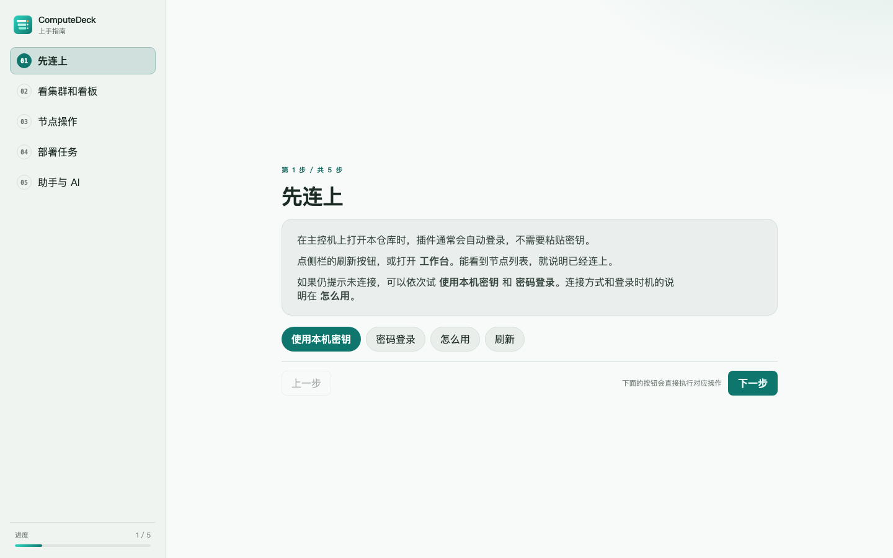

# ComputeDeck for VS Code

在编辑器里查看算力集群、打开终端、部署任务。

ComputeDeck 是一套多节点算力控制面：节点、任务、模型和推理入口共用同一份状态。这个插件是它在 VS Code / Cursor 里的客户端，重点解决“边写代码边看集群”的日常操作。



## 能做什么

| 入口 | 用途 |
|---|---|
| 左侧 ComputeDeck | 查看节点、任务、排队、入口 |
| 工作台 | 空闲卡、公告、常用操作、最近状态 |
| 五分钟上手 | 5 步上手指南，按钮可直接执行 |
| 打开完整看板 | 打开完整网页界面；从插件打开自动免密 |
| 打开小助手 | 在编辑器里对话，写操作先确认 |
| 配置小助手 API | 填模型地址、密钥、模型名 |
| 打开配置文件 | 在编辑器里直接改 cluster / nodes / jobs |
| 注册给 AI 用的工具 | 让 Copilot、Cursor 等通过 MCP 调 `gc_*` |
| 公告 | 原生列表，选中标记已读 |
| 排队与占卡 | 提交 Job、调度队列、取消排队 |
| 入口状态与启停 | 查看 Edge / LiteLLM / nginx，启停入口 |

侧栏节点行右侧有快捷按钮：终端、只读诊断、腾空。任务行有启动 / 重启 / 停止。危险操作会再确认一次。

## 安装

从 [GitHub Releases](https://github.com/AlexanderJ-Carter/ComputeDeck/releases) 下载 `computedeck-vscode-*.vsix`，然后：

```bash
code --install-extension computedeck-vscode-*.vsix
# 或 Cursor: cursor --install-extension ...
```

也可以从源码打包：

```bash
cd extensions/vscode
npm run package
code --install-extension computedeck-vscode-*.vsix
```

安装后执行 **Developer: Reload Window**。远程开发时插件运行在 Remote / CodeLab 的工作区扩展宿主上，不需要在本地桌面再装一份。

## 登录与免密

| 你在哪 | 插件 | 完整看板 |
|---|---|---|
| 主控本机 | 自动读本机 Token，免密 | 从插件打开：一次性票据，免密 |
| 主控本机，直接输网址 | — | 密码 / OIDC |
| 笔记本 / 内网 / 公网 | 需要 Token 或密码 | 密码 / OIDC |
| 工作节点 | 不需要网页密码 | 不需要，只走 SSH |

插件打开看板时会用本机 Bearer Token 换 90 秒、一次性的登录票据，再让浏览器换 Session；不会把长期 Token 放进 URL。

## 设置

| 设置 | 默认 | 说明 |
|---|---|---|
| `computedeck.apiBase` | `http://127.0.0.1:8787` | 主控地址 |
| `computedeck.autoLocalAuth` | `true` | 主控本机自动读 Token |
| `computedeck.uiOpenMode` | `auto` | 打开完整看板的方式 |
| `computedeck.pollIntervalSec` | `30` | 侧栏刷新间隔 |
| `computedeck.statusBar` | `true` | 显示节点 / GPU 状态 |
| `computedeck.mcpPath` | `${workspaceFolder}/bin/gpu-control-mcp` | MCP 工具路径 |
| `computedeck.sshUser` | 空 | 节点终端默认用户 |

## 开发

```bash
cd extensions/vscode
npm run check       # node --check
npm run package     # 产出 VSIX
```

结构：

- `extension.js`：API 客户端、侧栏、看板链接、上手指南、工作台、命令；
- `media/guide/*.md`：五分钟上手内容；
- `package.nls*.json` / `l10n/`：中英文文案；
- `media/`：图标与活动栏图标。

更多：https://github.com/AlexanderJ-Carter/ComputeDeck/blob/main/docs/vscode插件.md · https://github.com/AlexanderJ-Carter/ComputeDeck/blob/main/docs/接入拓扑与鉴权.md · https://github.com/AlexanderJ-Carter/ComputeDeck/blob/main/docs/产品故事.md。

## 许可

AGPL-3.0-only，见 https://github.com/AlexanderJ-Carter/ComputeDeck/blob/main/LICENSE。
